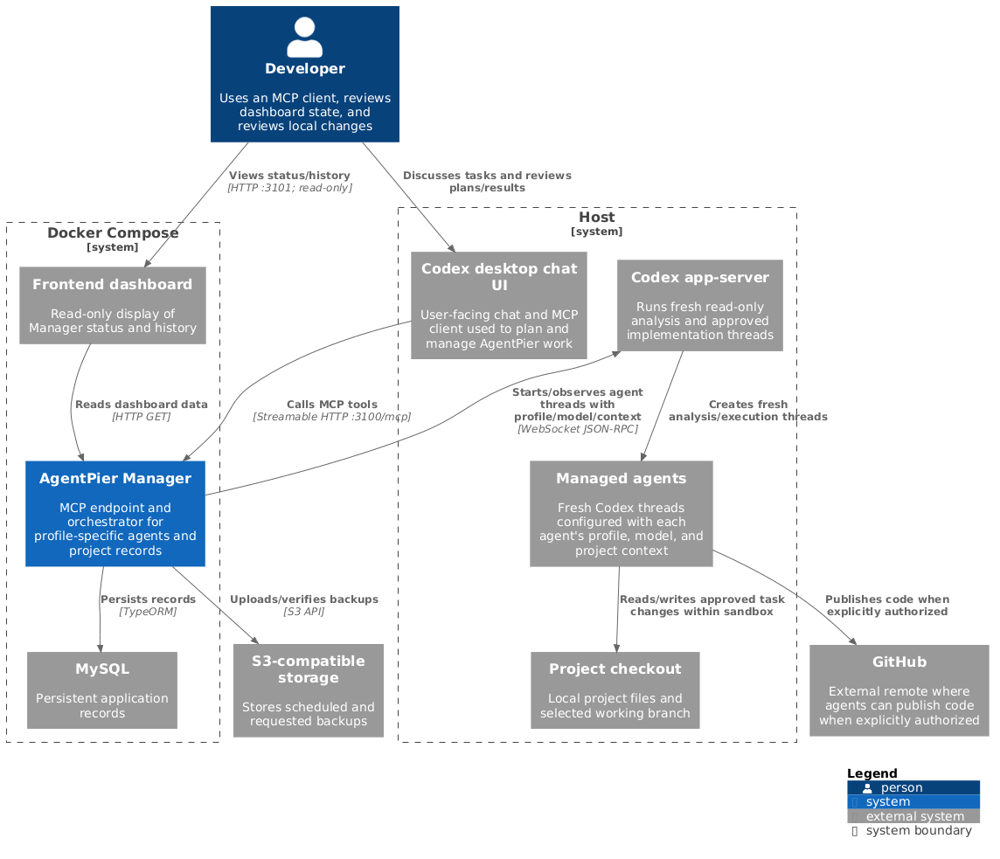
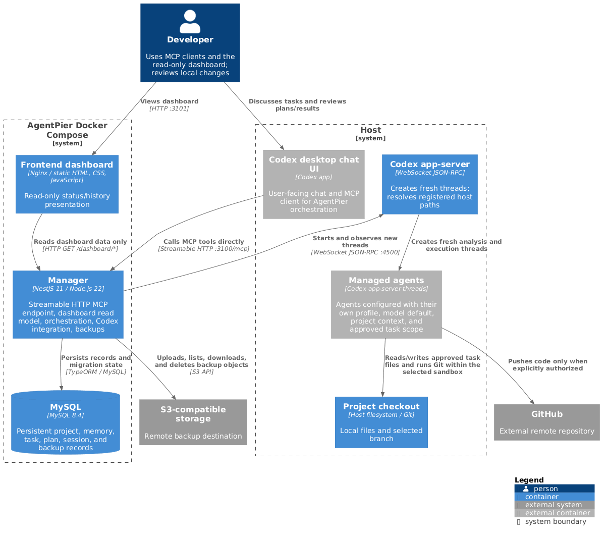

# AgentPier

AgentPier is a local project manager and MCP server for Codex work across several local applications and Git repositories. It stores project context and task history in MySQL, runs fresh Codex app-server threads for analysis and approved implementation, and leaves changes in local branches for the user to review. It never pushes, opens pull requests, or merges as part of a normal task.

## Repository layout

- `apps/frontend/` — read-only dashboard for displaying Manager state; it does not forward or call MCP tools.
- `apps/manager/` — NestJS Manager with the direct local MCP endpoint, dashboard read model, domain orchestration, integrations, and migrations. There are no REST write operations; task and project changes go through MCP. Each domain keeps controllers, services, entities, DTOs, types, and tests in separate folders.
- `agents/backend-nestjs/` — Backend NestJS profile and its NestJS skills.
- `agents/frontend-angular/` — Frontend Angular profile and its Angular skills.
- `orchestrator/instructions.md` — rules injected into each managed session.
- `docs/architecture/` — PlantUML C4 sources and exported PNG diagrams.
- `docker-compose.yml` — frontend, Manager, and MySQL; backups are stored in the configured remote S3 bucket.

Profile and skill files are the source of truth. Each profile's `AGENTS.md` and its `skills/<skill>/SKILL.md` files are versioned together and read on every launch; Manager saves their combined content hash in the session record. Confirmed, versioned project instruction records and confirmed memory are added to the session prompt; legacy project metadata is not treated as project instruction. The initial profiles are **Backend NestJS** and **Frontend Angular**: each can be reused across different projects that use the same framework. The profile instructions contain framework practices; each target project's `AGENTS.md` supplies its own architecture. Add a future profile by creating `agents/<profile>/AGENTS.md` and its local `skills/` folders; Manager discovers profiles from disk.

## Run locally

Requirements: macOS, Docker Desktop with Compose, Node 22 for local development, and Codex CLI/app-server installed on the Mac.

```sh
cp .env.example .env
# Set DB_PASSWORD and the remote S3 credentials. Leave S3_ENDPOINT empty for AWS S3, or set it for another remote S3-compatible provider.
docker compose up --build -d
docker compose ps
```

Open the dashboard at <http://localhost:3101>. Manager MCP is available directly at <http://localhost:3100/mcp>; ChatGPT/Codex clients do not pass through the dashboard. The dashboard only requests read-only display data from Manager. Compose persists MySQL in a named volume and runs TypeORM migrations before Manager starts. `docker compose down` keeps database data; `docker compose down -v` removes it.

For local development, install dependencies with `npm ci`, point `.env` at a MySQL server, then run `npm run migration:run` and `npm run start:dev`.

## Codex app-server and local paths

Run the app-server on macOS, outside Docker, listening on port 4500. Manager uses:

- Docker → Mac: `ws://host.docker.internal:4500`
- Mac-local client → app-server: `ws://127.0.0.1:4500`
- readiness and health: `http://host.docker.internal:4500/readyz` and `/healthz` from Manager's network namespace.

`manager_status` checks both HTTP endpoints and opens a real WebSocket connection with the app-server JSON-RPC `initialize` method. An HTTP 200 alone does not mean session control is working. The dashboard reads `GET /dashboard/status`; MCP clients can call `manager_status` for the concrete failure reason.

Register absolute **Mac paths**. The Manager container does not mount project checkouts. It sends the saved path in `thread/start` and `turn/start`; the host app-server resolves that exact path on the Mac. Applications and repositories must remain under the registered project root. Verify the intended path before analysis.

The installed Codex CLI accepts remote app-server connections. In an IDE terminal, a user can open the managed thread by its saved Codex session ID:

```sh
codex resume <codex-session-id> --remote ws://127.0.0.1:4500 -C /absolute/mac/project/path
```

`codex agents --remote ws://127.0.0.1:4500` opens the remote agent list. Manager always creates new threads; it does not take over existing sessions.

## MCP

The local Streamable HTTP endpoint is `http://localhost:3100/mcp`, published directly by the Manager container. The dashboard runs separately at `http://localhost:3101` and is not in the MCP request path. If a supported tunnel is configured for hosted ChatGPT, it forwards directly to Manager port 3100. Manager implements MCP `initialize`, `tools/list`, and `tools/call` through the same NestJS services and MySQL used by the UI. The tools cover project/application registration, transactional project deletion (including project-owned task history while keeping checkout files), profile/model reads and model selection, context reads, analysis, planning, explicit approval, execution, messages, cancellation, results, and backups. Each executable step must name a user-selected target branch; AgentPier never creates or switches branches automatically. If the selected branch is not checked out, execution waits for the user to check it out. `docs/mcp.md` lists tool arguments and an example client setup.

**Hosted MCP connection limitation:** Hosted clients cannot connect directly to `localhost`. A separately configured supported tunnel must forward requests to Manager at `http://localhost:3100/mcp`; do not route MCP through the dashboard. Follow the client's current setup instructions. AgentPier does not claim or verify any client GUI flow. See [OpenAI's MCP connection guide](https://help.openai.com/en/articles/12584461-connecting-custom-mcp-servers-in-chatgpt).

## Projects and workflow

Register a project with an absolute local root. Then register one `repository` record per Git clone and one `app` record per application, linking each app to its repository. A project can contain multiple apps and repositories. Remote URLs are metadata; local branch and status operations use Git through the host app-server. Cloning a remote into a new local path is not yet exposed as a Manager operation.

The workflow is:

1. Call `analyze_task` with the verbatim user request. Manager selects the Backend NestJS or Frontend Angular profile for each application and starts new read-only threads. It saves thread IDs, profile and project instruction hashes, events, messages, and reports.
2. Discuss the analysis with the user and use `save_plan` to store a draft. Analysis must finish before planning.
3. Call `approve_plan` only after explicit user confirmation (`userConfirmed: true`). Manager stores the approved plan separately and refuses execution before approval.
4. Ensure every step names the user-selected `targetBranch`; ask and wait if any branch is unspecified. Call `execute_task` only after approval. Manager validates the selected branches and dependency graph, refuses to switch away from the checked-out branch, serializes tasks targeting the same checkout, starts a workspace-write session, and passes completed dependency results into downstream prompts.
5. Poll status/messages/results. Answer app-server user-input requests or send further instructions. Cancel interrupts active turns and retains history.
6. Review changed files, branch names, diff summaries, and reported checks in the local IDE. Push, PR, and merge remain a separate user decision.

Status values include `analysis_running`, `analysis_complete`, `plan_draft`, `approved`, `executing`, `blocked`, `cancelled`, and `review_ready`. A blocked task with an approved plan can be retried without losing its request or plan.

## Memory and data

MVP records are stored in the MySQL `manager_records` table with a kind, project association, JSON data and timestamps. Domain boundaries and provenance are described in [docs/domain-model.md](docs/domain-model.md). Confirmed context is passed into new analysis sessions; agent output is kept as output and is not automatically promoted to confirmed memory. Do not store secrets in project notes or prompts.

## Backups and restore

Manager writes scheduled and requested MySQL snapshots to the configured remote S3 bucket. For AWS S3, set credentials, region, and bucket and leave `S3_ENDPOINT` empty. For another remote S3-compatible provider, set its endpoint and path-style option too. `BACKUP_SCHEDULE` controls the schedule; `BACKUP_RETENTION_COUNT` keeps the five newest backups by default.

Call MCP `backup_database` with `verifyRestore: true` to upload a consistent MySQL snapshot, download it, validate its checksum, restore it into the isolated `agentpier_restore_test` database, and compare row counts and content checksums. Each operation records status, time, object key, size, checksum, restore result, retention result, and sanitized errors. The dashboard shows configured bucket connectivity without displaying credentials.

See [docs/backup-restore.md](docs/backup-restore.md) for the recovery process and limits.

## Checks and limits

Run `npm run build`, `npm test -- --runInBand`, and `npm run lint`. Local MCP tool calls, live app-server model listing/session startup, and browser/CUA GUI behavior are not verified in the current environment because of sandbox/tool connectivity limits; WebStorm launch is not claimed. Remote S3 backup requires reachable credentials and a bucket; no successful upload is claimed. Hosted clients cannot reach the local MCP endpoint without a separately configured supported tunnel. Remote GitHub operations and remote cloning are outside the local MVP. The dashboard is a separate static frontend container; it is not an Angular application.

## Architecture diagrams

### C4 Context



Source: [c4-context.puml](docs/architecture/c4-context.puml).

### C4 Container



Source: [c4-container.puml](docs/architecture/c4-container.puml).

See [docs/mcp.md](docs/mcp.md) for MCP tool contracts.

### Per-profile reasoning and selective skills

Use MCP `update_agent_profile` with `role` and `model` and/or `defaultReasoningEffort`. The initial effort is `medium`; supported values come from the selected model's live `list_models` catalog. Task turns pin model/effort in session evidence. Skills are selected for the task/application instead of attaching the complete catalog, and execution handoffs include only declared dependency summaries. See [MCP contracts](docs/mcp.md#profile-reasoning-and-task-context).

Managed agent turns request network access without changing filesystem or approval restrictions; see [session network policy](docs/mcp.md#managed-session-network-policy).

Managed publication requires explicit typed `steps[].releaseOperations` in the persisted user-approved plan; ordinary sessions remain network-disabled and unpublished. See [scoped release policy](docs/mcp.md#managed-session-network-policy).
