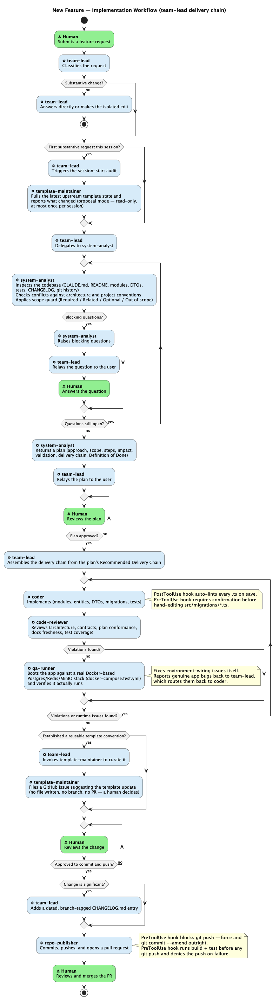

# NestJS Project Template

A production-ready NestJS template with pre-wired infrastructure modules for rapid service development.

---

## Tech Stack

| Layer | Technology |
|---|---|
| Framework | NestJS 11 (Express) |
| Language | TypeScript 5.7 |
| Database | PostgreSQL + TypeORM 0.3 |
| Cache | Redis (ioredis) |
| Object Storage | S3-compatible (MinIO locally) |
| Validation | class-validator + class-transformer |
| Documentation | Swagger / OpenAPI |
| Auth | API key guard |

---

## Project Structure

```
src/
├── common/
│   ├── database/          # TypeORM PostgreSQL module + DataSource for CLI migrations
│   ├── redis/             # Global RedisService with get/set/del/smembers helpers
│   ├── s3/                # Global S3StorageService (uploadFile, deleteFile)
│   ├── http/              # HttpService — fetch wrapper with configurable retry + backoff
│   ├── error/             # Global exception filter → { statusCode, path, message }
│   ├── logging/           # LoggingService wrapper over NestJS Logger
│   ├── guards/            # ApiKeyGuard — X-API-KEY header validation
│   └── dto/               # Shared DTOs: PaginatedResponseDto
├── health/                # GET /health — app name, env, uptime
│   ├── controllers/
│   ├── services/
│   └── dto/
├── migrations/            # TypeORM migration files
├── app.module.ts
└── main.ts                # Bootstrap: CORS, ValidationPipe, Swagger
```

---

## Infrastructure Modules

### `DatabaseModule`
Connects to PostgreSQL via TypeORM. `autoLoadEntities: true`, `synchronize: false` (migrations-based schema management). Loads Docker secrets before connecting.
Configured via `DB_HOST`, `DB_PORT`, `DB_USER`, `DB_PASSWORD`, `DB_NAME`.

### `RedisModule` (global)
ioredis client with exponential retry strategy (max 2000ms delay).
Exposes `RedisService` with `get`, `set` (optional TTL), `del`, `smembers`, `sadd`, `expire`, `isConnected`.
Configured via `REDIS_HOST`, `REDIS_PORT`, `REDIS_PASSWORD`.

### `S3Module` (global)
AWS SDK v3 S3 client. Gracefully no-ops if credentials are missing — the service throws `InternalServerErrorException` only when an operation is actually attempted.
Exposes `S3StorageService` with `uploadFile` and `deleteFile`.
Configured via `S3_ENDPOINT`, `S3_REGION`, `S3_ACCESS_KEY`, `S3_SECRET_KEY`, `S3_BUCKET`, `S3_FORCE_PATH_STYLE`.

### `HttpModule`
Native `fetch`-based HTTP client with configurable timeout, retry count, and exponential backoff.
Import into any feature module that needs to call external services.
Exposes `HttpService` with `get`, `post`, `put`, `patch`, `delete` convenience methods.
Configured via `HTTP_TIMEOUT_MS`, `HTTP_RETRIES`, `HTTP_RETRY_DELAY_MS`.

### `ErrorModule`
Global `APP_FILTER` that catches all unhandled exceptions and returns a consistent JSON error shape:
```json
{ "statusCode": 400, "path": "/resource", "message": "Validation failed" }
```

### `LoggingService`
Thin wrapper over NestJS `Logger`. Always instantiate with a context string via `useFactory`:
```ts
{
  provide: LoggingService,
  useFactory: () => new LoggingService('MyService'),
}
```

### `ApiKeyGuard`
Validates `X-API-KEY` header against `API_KEY` env var. Apply per-controller or per-route with `@UseGuards(ApiKeyGuard)`.

### `HealthModule`
Simple `GET /health` endpoint returning `appName`, `environment`, and `uptime`.

---

## Docker Secrets

`loadDockerSecrets()` (called in `main.ts` and `database.module.ts`) reads files from `/run/secrets/` and injects them as environment variables. Existing env vars take precedence, so it is safe to call multiple times.

---

## Getting Started

### Prerequisites

- Node.js 22+
- PostgreSQL
- Redis
- MinIO (optional, for S3 functionality)

### Setup

```bash
# Install dependencies
npm install

# Copy env file and fill in values
cp .env.example .env

# Run database migrations
npm run migration:run

# Start in development (watch) mode
npm run start:dev
```

### Swagger UI

Available at: [http://localhost:3000/docs](http://localhost:3000/docs)

### Health check

```
GET /health
```

---

## Database Migrations

```bash
# Generate a new migration after changing entities
npm run migration:generate -- src/migrations/MigrationName

# Apply pending migrations
npm run migration:run

# Revert the last migration
npm run migration:revert

# Show migration status
npm run migration:show
```

---

## Testing

```bash
# Unit tests
npm run test

# Watch mode
npm run test:watch

# Coverage report
npm run test:cov

# E2E tests
npm run test:e2e
```

---

## Linting & Formatting

```bash
# Lint with auto-fix (ESLint)
npm run lint

# Format source files (Prettier)
npm run format
```

ESLint config lives in `eslint.config.mjs`, Prettier config in `.prettierrc`. `printWidth` is set to `120` to match this codebase's existing line-length conventions, and `@typescript-eslint/no-explicit-any` is disabled to match its established use of `any` (see `noImplicitAny: false` in `tsconfig.json`).

---

## Adding a Feature Module

1. Create `src/<feature>/<feature>.module.ts` with controllers, services, and DTOs.
2. Import `HttpModule` or inject `RedisService` / `S3StorageService` as needed (both are global).
3. Register the module in `AppModule`.
4. Generate a migration for any new entities: `npm run migration:generate -- src/migrations/AddFeature`.

---

## Claude Agent Workflow

This repo uses a role-based set of Claude Code agents under `.claude/agents/`. `team-lead` is the single entry point and workflow owner for any request; it classifies the request and routes accordingly:

| Agent | Role |
|---|---|
| `team-lead` | Entry point and workflow owner. Classifies requests, orchestrates the rest, updates `CHANGELOG.md` itself, and asks the user to approve the change before it ships. |
| `system-analyst` | Planning-only: discovery, conflict/risk analysis, scope, and an implementation plan. No code, no commits. |
| `template-maintainer` | Owns both directions of template alignment: compares this project's agents/skills/instructions against the upstream template and proposes (or, once approved, applies) updates, and judges whether a new convention this project just built belongs in the shared template instructions. |
| `coder` | Implementation specialist for modules, entities, API contracts, and migrations. |
| `code-reviewer` | Reviews changes against template architecture. |
| `qa-runner` | Boots the app against a real Docker-based Postgres/Redis/MinIO stack (`docker-compose.test.yml`) to catch runtime issues static review can't. |
| `repo-publisher` | Terminal step: confirms with the user, then commits, pushes, and opens a PR. Never merges. |

Delegation always flows `team-lead → system-analyst → team-lead → specialists → code-reviewer → qa-runner → team-lead → repo-publisher` (or `team-lead → template-maintainer → team-lead → ...` for template sync). A session-start hook prompts `team-lead` to run one `template-maintainer` audit per session. See `CLAUDE.md` for the full orchestration rules.

The full block scheme (source: `feature-implementation-workflow.puml`):



## Local Verification (Docker)

`docker-compose.test.yml` at the repo root spins up Postgres, Redis, and MinIO plus the app itself for real runtime verification before a change ships — owned by the `qa-runner` agent, separate from the mock-based unit tests in `minimal-test-strategy`.

```bash
docker compose -f docker-compose.test.yml up -d --wait
docker compose -f docker-compose.test.yml logs
docker compose -f docker-compose.test.yml down -v
```

---

## Environment Variables

See `.env.example` for all variables with descriptions.