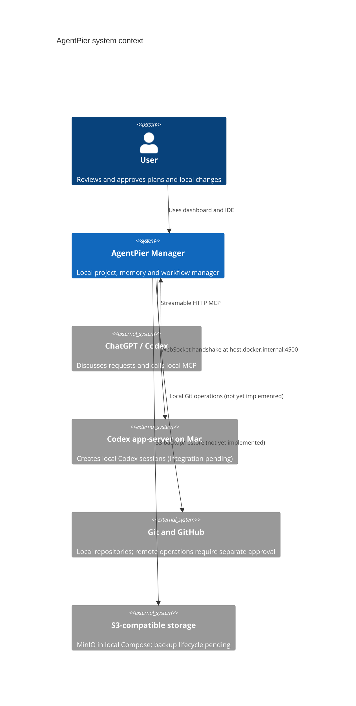
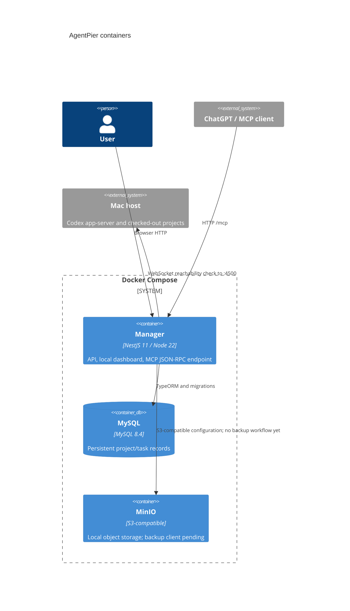

# Architecture and local integration

## C4 Context

## C4 Container

## Readiness and WebSocket diagnosis

Manager requests `http://host.docker.internal:4500/readyz` and `/healthz`, then opens a genuine WebSocket handshake to `ws://host.docker.internal:4500`. HTTP success alone is not reported as a WebSocket connection. `/api/status` and the MCP `manager_status` tool return the handshake result and failure reason. If unavailable, start the app-server on the Mac and verify it listens on port 4500 and that Docker can reach it. Session protocol negotiation and thread/turn operations are not implemented yet.

The running session's `cwd` must be the absolute Mac path stored in the project/app record. Manager currently does not launch sessions, so the actual path mapping remains unverified. The app-server process on the host, not a Docker volume, provides host filesystem access.
