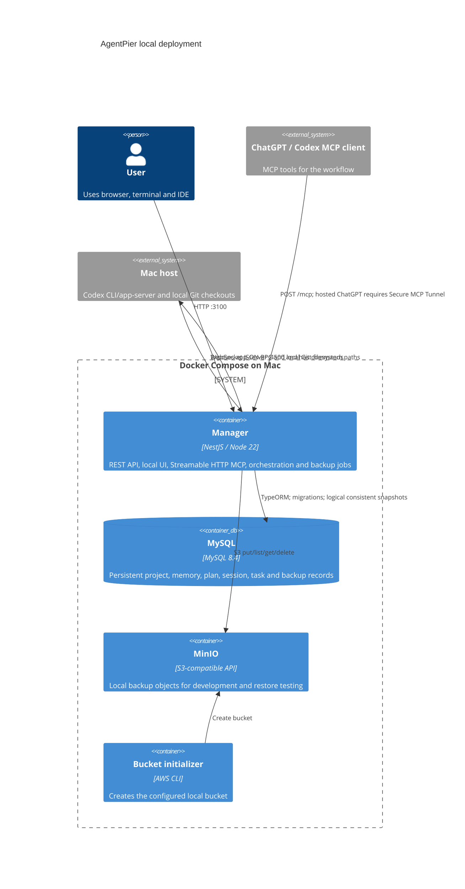

# C4 Container

Manager does not contain Codex CLI, mount project directories, or start a host agent. The app-server on the Mac resolves the absolute paths it receives from registered project/application records. HTTP readiness and health probes supplement a real WebSocket `initialize` request; only the latter proves a control connection.
