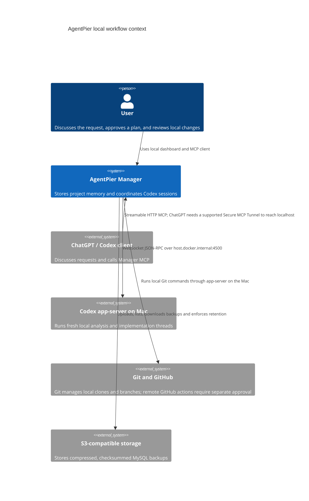

# C4 Context

AgentPier remains local. ChatGPT's hosted custom MCP connection cannot connect directly to a loopback endpoint; see [MCP setup](../mcp.md) for the separately required tunnel condition.
